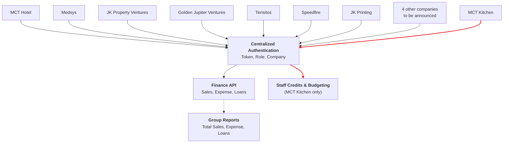

# MCT Financial Management System: Data Flow

This document describes how the 12 company systems connect to the MCT Financial Management System and how data moves between them.

## 1. Overview

All companies sign in through one **Centralized Authentication**, which provides the user's token, role, and company. After authentication, requests go to the **Finance API** (sales, expense, loans). The Finance API feeds the **Group Reports**, which show total sales, expense, and loans across the companies.

**Staff Credits & Budgeting** is a special feature available to **MCT Kitchen only**. It is reached through Centralized Authentication, not through the shared Finance API.

## 2. Data Flow Diagram

Red arrows mark the MCT Kitchen path to its Kitchen-only feature. The dashed arrow marks the reporting feed.

## 3. Companies

The system serves 12 companies.

| # | Company | Status |
|---|---|---|
| 1 | MCT Hotel | Confirmed |
| 2 | MCT Kitchen | Confirmed (has the Kitchen-only feature) |
| 3 | Medsys | Confirmed |
| 4 | JK Property Ventures | Confirmed |
| 5 | Golden Jupiter Ventures | Confirmed |
| 6 | Terisitos | Confirmed |
| 7 | Speedfire | Confirmed |
| 8 | JK Printing | Confirmed |
| 9 to 12 | Four other companies | To be announced |

## 4. Data Flow Steps

1. **Company users sign in.** Every company connects to Centralized Authentication.
2. **Centralized Authentication identifies the user.** It provides the **token**, the **role**, and the **company** of the user.
3. **Finance requests go to the Finance API.** Authenticated requests for sales, expense, and loans are handled by the Finance API.
4. **Group Reports are produced.** The Finance API feeds the Group Reports, which show total sales, expense, and loans.
5. **MCT Kitchen uses its special feature.** MCT Kitchen users are also routed from Centralized Authentication to Staff Credits & Budgeting. This feature is for MCT Kitchen only.

## 5. Components

| Component | Provides | Used by |
|---|---|---|
| Centralized Authentication | Token, Role, Company | All 12 companies |
| Finance API | Sales, Expense, Loans | Authenticated users of all companies |
| Group Reports | Total Sales, Expense, Loans | Fed by the Finance API |
| Staff Credits & Budgeting | Staff credits and budgeting | MCT Kitchen only |

## 6. Notes

- Four of the 12 companies are still to be announced. When they are named, they connect to Centralized Authentication in the same way as the others.
- The Kitchen-only feature does not feed the Group Reports in this design.
