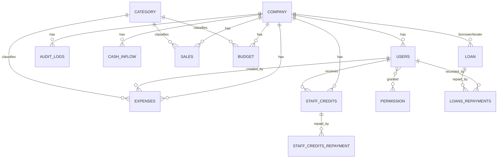

# MCT Companies Financial Management: ERD

Multi-tenant finance system. Most tables are scoped by `Company_ID`.
All PKs/FKs are `bigint`. Cardinalities below are the **intended** ones (inferred from FKs), not as drawn.

## Tables

Format: `Column (type)`. PK = primary key, FK = foreign key. Every table also has `Created_At`, `Updated_At` (timestamp) unless noted.

| Table | Columns |
|---|---|
| **Company** | Company_ID PK, Name (varchar), Company Name (varchar),Location(varchar),Contact Person(varchar),Contact Number(String(8), nullable=True), Phone(String(11), nullable=True), Email(varchar), Starting_Balance (decimal), Current_Balance (decimal) |
| **Users** | User_ID PK, Company_ID FK, Name, Email, Password (hash!), Last_Login_At (timestamp), Is_Admin (boolean) |
| **Permission** | Permission_ID PK, Name |
| **Audit_Logs** | Audit_Log_ID PK, Company_ID FK, Action (varchar), Created_At only |
| **Cash_Inflow** | Cash_Transaction_ID PK, Company_ID FK, Transaction_Date (date), Transaction_Type (varchar), Amount (decimal), Reference_No, Description |
| **Sales** | Sales_ID PK, Company_ID FK, Category_ID FK, Transaction_Date (date), Reference_No, Amount (decimal 15,2), Description (text) |
| **Expenses** | Expense_ID PK, Company_ID FK, Category_ID FK, Created_By FK→Users, Expense_Date (date), Reference_No, Amount, Amount_Paid (decimal), Description (text) |
| **Budget** | Budget_ID PK, Company_ID FK, Category_ID FK, Amount (decimal), Period_Type (varchar), Start_Date, End_Date (date), Description (text) |
| **Category** | Category_ID PK, Name, Description (text) |
| **Loan** | Loan_ID PK, Borrower FK, Lender FK (→Company), Loan_Ref_No, Principal_Amount, Interest_Rate (decimal), Interest_Type (varchar), Loan_Date, Due_Date (date), Description (text) |
| **Loans_Repayments** | Loan_Repayment_ID PK, Loan_ID FK, Recorded_By FK→Users, Payment_Date, Due_Date (date), Remaining_Balance, Amount (decimal), Reference_No, Status (varchar), Received_At (timestamp), Notes (text) |
| **Staff_Credits** | Staff_Credit_ID PK, Company_ID FK, User_ID FK, Amount (decimal), Credit_Date, Due_Date (date), Status (varchar), Purpose (text), Notes (text) |
| **Staff_Credits_Repayment** | Repayment_ID PK, Staff_Credit_ID FK, Payment_Date (date), Amount (decimal), Payment_Method, Reference_No, Status (varchar), Received_At (timestamp), Notes (text) |
