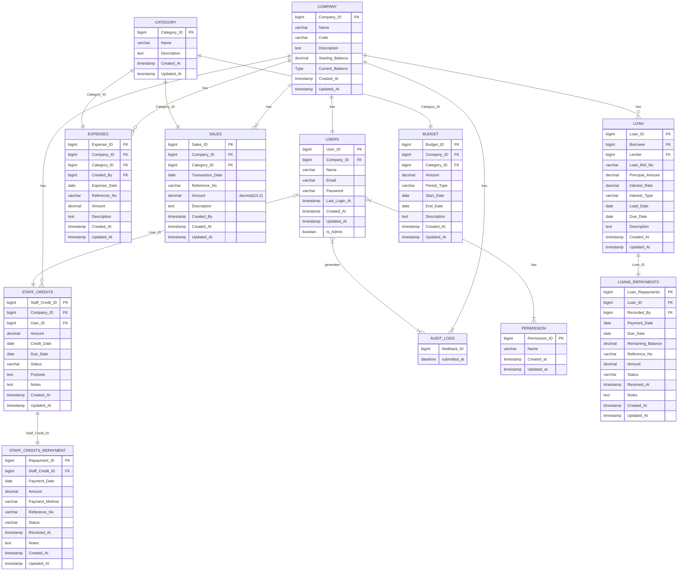

# Entity Relationship Diagram

**MCT Companies Financial Management**

## Diagram

## Tables

### Company

| Column | Type | Key |
|---|---|---|
| Company_ID | bigint | PK |
| Name | varchar | |
| Code | varchar | |
| Description | text | |
| Starting_Balance | decimal | |
| Current_Balance | Type (placeholder) | |
| Created_At | timestamp | |
| Updated_At | timestamp | |

### Users

| Column | Type | Key |
|---|---|---|
| User_ID | bigint | PK |
| Company_ID | bigint | FK |
| Name | varchar | |
| Email | varchar | |
| Password | varchar | |
| Last_Login_At | timestamp | |
| Created_At | timestamp | |
| Updated_At | timestamp | |
| Is_Admin | boolean | |

### Permission

| Column | Type | Key |
|---|---|---|
| Permission_ID | bigint | PK |
| Name | varchar | |
| Created_at | timestamp | |
| Updated_at | timestamp | |

### Audit Logs

| Column | Type | Key |
|---|---|---|
| feedback_ID | bigint | |
| submitted_at | datetime | |

### Staff Credits

| Column | Type | Key |
|---|---|---|
| Staff_Credit_ID | bigint | PK |
| Company_ID | bigint | FK |
| User_ID | bigint | FK |
| Amount | decimal | |
| Credit_Date | date | |
| Due_Date | date | |
| Status | varchar | |
| Purpose | text | |
| Notes | text | |
| Created_At | timestamp | |
| Updated_At | timestamp | |

### Staff Credits Repayment

| Column | Type | Key |
|---|---|---|
| Repayment_ID | bigint | PK |
| Staff_Credit_ID | bigint | FK |
| Payment_Date | date | |
| Amount | decimal | |
| Payment_Method | varchar | |
| Reference_No | varchar | |
| Status | varchar | |
| Received_At | timestamp | |
| Notes | text | |
| Created_At | timestamp | |
| Updated_At | timestamp | |

### Budget

| Column | Type | Key |
|---|---|---|
| Budget_ID | bigint | PK |
| Company_ID | bigint | FK |
| Category_ID | bigint | FK |
| Amount | decimal | |
| Period_Type | varchar | |
| Start_Date | date | |
| End_Date | date | |
| Description | text | |
| Created_At | timestamp | |
| Updated_At | timestamp | |

### Expenses

| Column | Type | Key |
|---|---|---|
| Expense_ID | bigint | PK |
| Company_ID | bigint | FK |
| Category_ID | bigint | FK |
| Created_By | bigint | FK |
| Expense_Date | date | |
| Reference_No | varchar | |
| Amount | decimal | |
| Description | text | |
| Created_At | timestamp | |
| Updated_At | timestamp | |

### Sales

| Column | Type | Key |
|---|---|---|
| Sales_ID | bigint | PK |
| Company_ID | bigint | FK |
| Category_ID | bigint | FK |
| Transaction_Date | date | |
| Reference_No | varchar | |
| Amount | decimal(15,2) | |
| Description | text | |
| Created_By | timestamp | |
| Created_At | timestamp | |
| Updated_At | timestamp | |

### Loan

| Column | Type | Key |
|---|---|---|
| Loan_ID | bigint | PK |
| Borrower | bigint | FK |
| Lender | bigint | FK |
| Loan_Ref_No | varchar | |
| Principal_Amount | decimal | |
| Interest_Rate | decimal | |
| Interest_Type | varchar | |
| Load_Date | date | |
| Due_Date | date | |
| Description | text | |
| Created_At | timestamp | |
| Updated_At | timestamp | |

### Loans Repayments

| Column | Type | Key |
|---|---|---|
| Loan_Repayments | bigint | PK |
| Loan_ID | bigint | FK |
| Recorded_By | bigint | FK |
| Payment_Date | date | |
| Due_Date | date | |
| Remaining_Balance | decimal | |
| Reference_No | varchar | |
| Amount | decimal | |
| Status | varchar | |
| Received_At | timestamp | |
| Notes | text | |
| Created_At | timestamp | |
| Updated_At | timestamp | |

### Category

| Column | Type | Key |
|---|---|---|
| Category_ID | bigint | PK |
| Name | varchar | |
| Description | text | |
| Created_At | timestamp | |
| Updated_At | timestamp | |

## Relationships

| From | To | Cardinality (as drawn) |
|---|---|---|
| Company | Users | One to one |
| Company | Staff Credits | One to many (optional) |
| Company | Expenses | One to many (optional) |
| Company | Sales | One to many |
| Company | Loan | One to many (optional) |
| Company | Audit Logs | One to many |
| Users | Staff Credits | One to zero-or-one |
| Users | Permission | Many to many |
| Users | Audit Logs | Many to many |
| Staff Credits | Staff Credits Repayment | One to one |
| Loan | Loans Repayments | One to one |
| Category | Budget | One to one |
| Category | Expenses | One to one |
| Category | Sales | One to one |

## Changes from the previous version

- **Company:** added `Starting_Balance`, `Current_Balance` and `Updated_At`.
- **Expenses:** removed `Payment_Method`.
- **Sales:** removed `Payment_Method`.
- **Loans Repayments:** removed `Payment_Method`, added `Remaining_Balance`.
- Relationships are unchanged.

## Notes on the source diagram

Carried over as drawn. Worth reviewing before implementation:

- **Company.Current_Balance:** its type is literally "Type" in the diagram, which looks like a placeholder (probably `decimal`).
- **Cardinalities:** several relationships (Company-Users, Category-Budget/Expenses/Sales, Staff Credits-Repayment, Loan-Repayments) are drawn as one-to-one, but are most likely one-to-many.
- **Budget:** has a `Company_ID` FK but no line to Company in the diagram.
- **Audit Logs:** only has `feedback_ID` and `submitted_at` (no PK marker, no user/action columns), and the name suggests feedback rather than audit data.
- **Loan:** `Load_Date` is probably meant to be `Loan_Date`. `Borrower` and `Lender` are FKs with no target table shown.
- **Sales:** `Created_By` is typed `timestamp`; it is probably meant to be a `bigint` FK to Users.
- **Naming:** `Loans Repayments` uses `Loan_Repayments` as its PK name, and column casing is inconsistent (`Created_at` vs `Created_At`).
- **Types:** `decimal` is used without precision except for `Sales.Amount` (`decimal(15,2)`).
