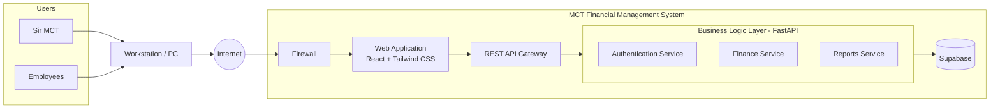

# MCT Financial Management System: System Architecture

This document describes the final system architecture of the MCT Financial Management System.

## 1. Overview

The MCT Financial Management System is a web-based platform that digitalizes financial operations: sales, expenses, and loans. Users reach the system from a workstation over the internet. Requests pass through a firewall to the web application, then through a REST API gateway to the business logic layer, which reads and writes data in Supabase.

## 2. Architecture Diagram

## 3. Request Flow

1. **Users**: Sir MCT and the employees use the system.
2. **Workstation/PC**: Users access the system from their workstation.
3. **Internet**: The workstation connects to the system over the internet.
4. **Firewall**: Incoming traffic first passes through the firewall.
5. **Web Application**: The firewall forwards allowed traffic to the web application (React and Tailwind CSS).
6. **REST API Gateway**: The web application sends its API calls through the REST API gateway.
7. **Business Logic Layer (FastAPI)**: The gateway routes each request to the Authentication, Finance, or Reports Service.
8. **Supabase**: The services read and write data in the Supabase database.

## 4. Components

### 4.1 Users and Access

| Component | Description |
|---|---|
| Sir MCT | Management user of the system |
| Employees | Staff who use the system |
| Workstation/PC | Device used to access the web application |
| Internet | Network connecting users to the system |

### 4.2 MCT Financial Management System

| Component | Technology | Description |
|---|---|---|
| Firewall | n/a | Entry point that filters incoming traffic before it reaches the web application |
| Web Application | React, Tailwind CSS | User interface for sales, expenses, loans, and reports |
| REST API Gateway | REST | Single entry point for API calls from the web application to the business logic layer |
| Business Logic Layer | FastAPI (Python) | Backend that holds the system's services |
| Supabase | Supabase | Database where the system's data is stored |

### 4.3 Business Logic Layer Services

| Service | Responsibility |
|---|---|
| Authentication Service | Handles user login and verifies who the user is and what they may access |
| Finance Service | Handles the financial records: sales, expenses, and loans |
| Reports Service | Produces financial summaries and reports from the recorded data |

## 5. Technology Stack

| Layer | Technology |
|---|---|
| Frontend | React, Tailwind CSS |
| Backend | FastAPI (Python) |
| Database | Supabase |
